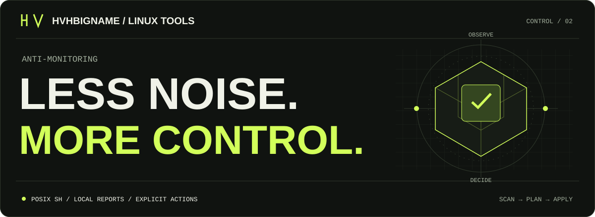

<picture>
  <source media="(prefers-color-scheme: light)" srcset="./assets/hero-light.svg">
  
</picture>

**Управление гостевыми агентами Linux. Один скрипт — все действия флагами.**

[](https://github.com/HVHBIGNAME/anti-monitoring/actions/workflows/ci.yml)
· [English](./docs/README.en.md) · [MIT](./LICENSE)

## Запуск

Открыть меню без установки:

```sh
curl -fsSL https://raw.githubusercontent.com/HVHBIGNAME/anti-monitoring/main/antimon.sh | sudo sh -s -- --menu
```

Установить команду `antimon`:

```sh
curl -fsSL https://raw.githubusercontent.com/HVHBIGNAME/anti-monitoring/main/antimon.sh | sudo sh -s -- --install
```

Под root убери `sudo`. Вместо `--menu` или `--install` можно передать любые флаги ниже.

## Флаги

| Флаг | Действие |
| :-- | :-- |
| `--help` / `-h` | Полная справка и примеры |
| `--scan` | Проверить агенты без изменений |
| `--list` | Показать доступные ID агентов |
| `--disable` | Отключить выбранные службы |
| `--remove` | Отключить службы и удалить пакеты |
| `--restore` | Восстановить состояния служб из снимка |
| `--agents qemu,aws-ssm` | Выбрать агенты по ID |
| `--all` | Выбрать все агенты |
| `--dry-run` | Только показать план |
| `--yes` | Выполнить без подтверждения |
| `--install` / `--uninstall` | Установить / удалить сам инструмент |
| `--autostart` / `--no-autostart` | Включить / выключить запуск при загрузке Linux |
| `--run` | Открыть меню сразу после `--install` |
| `--prefix DIR` | Свой каталог установки |
| `--lang ru` / `--lang en` | Язык интерфейса |

## Примеры

```sh
antimon --scan
antimon --disable --agents qemu --dry-run
sudo antimon --disable --agents qemu --yes
sudo antimon --restore

# Автостарт выключен по умолчанию. При загрузке он отключает выбранные агенты.
sudo antimon --autostart --agents qemu --yes
sudo antimon --no-autostart

# Установка и настройка автостарта одним вызовом из скачанного файла:
sudo sh antimon.sh --install --autostart --agents qemu --yes
```

Автозапуск — системная служба: нужен root-owned префикс (`/usr/local` или свой системный). Установка в `~/.local` для автостарта не подходит.

Linux: APT, RPM, pacman, APK, XBPS · systemd, OpenRC, runit, SysV.
Отключение агентов может повлиять на функции VM; доступ к гипервизору оно не блокирует.

[Дополнительные параметры и отчёты](./docs/USAGE.md) · [Совместимость и тесты](./docs/COMPATIBILITY.md)
