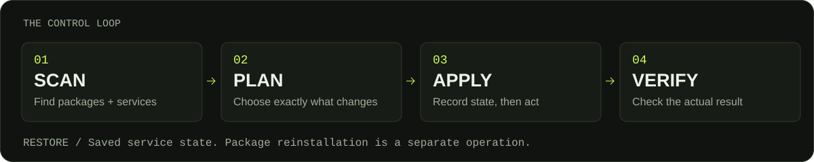
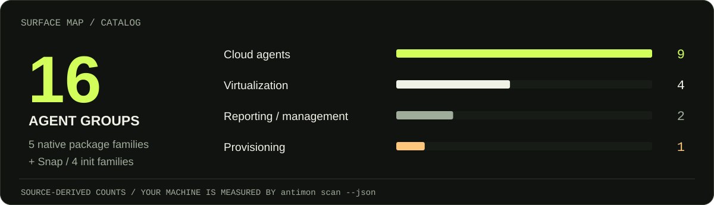

<picture>
  <source media="(prefers-color-scheme: light)" srcset="./assets/hero-light.svg">
  
</picture>

<p align="center">
  <a href="#quick-start">Установка</a> &nbsp; / &nbsp;
  <a href="#control-loop">Как пользоваться</a> &nbsp; / &nbsp;
  <a href="#compatibility">Совместимость</a> &nbsp; / &nbsp;
  <a href="#local-reports">Отчёты</a> &nbsp; / &nbsp;
  <a href="./docs/README.en.md">English ↗</a>
</p>

<p align="center">
  <a href="https://github.com/HVHBIGNAME/anti-monitoring/actions/workflows/ci.yml"></a>
  
  <a href="./LICENSE"></a>
</p>

**Найди гостевые агенты, посмотри план и управляй только выбранными компонентами.**

Anti-Monitoring — небольшой Linux CLI для QEMU, VMware, облачных агентов и систем
отчётности. Обычная команда `antimon`, понятный выбор действий, проверка результата
и снимки состояния служб. Основной скрипт работает на **POSIX sh** — Python, Bash,
Node.js и установка библиотек для него не нужны.

> Область действия — **внутри гостевой ОС**. Доступ провайдера к гипервизору,
> дискам, памяти VM и внеполосной консоли остаётся за этой границей.

<a id="quick-start"></a>
## Quick start

### Одна команда → установка и меню

```sh
curl -fsSL https://raw.githubusercontent.com/HVHBIGNAME/anti-monitoring/main/install.sh | sudo sh -s -- --run
```

Если ты уже работаешь под **root**, убери `sudo`. Для загрузки через `wget`:

```sh
wget -qO- https://raw.githubusercontent.com/HVHBIGNAME/anti-monitoring/main/install.sh | sudo sh -s -- --run
```

Установщик разрешает Git ref в конкретный commit, проверяет **SHA-256** и синтаксис,
затем атомарно устанавливает `/usr/local/bin/antimon`. Меню начинается с выбора
действия; установка сама по себе не отключает и не удаляет агентов.

```text
1  Проверка   2  План отключения   3  Отключить   4  Удалить   5  Восстановить   0  Выход
```

Интерфейс выбирает язык по локали. Можно явно передать `--lang ru` или `--lang en`.
В скриптах и пайплайнах вывод обычный текст, без ANSI-кодов.

<details>
<summary><b>Локальная установка, свой каталог и установка без сети</b></summary>

Без `sudo` команда устанавливается в `~/.local/bin/antimon`:

```sh
curl -fsSL https://raw.githubusercontent.com/HVHBIGNAME/anti-monitoring/main/install.sh | sh
~/.local/bin/antimon scan
sudo "$HOME/.local/bin/antimon" disable --agents qemu
```

Из скачанного репозитория, включая полностью офлайн-установку:

```sh
sudo sh install.sh --source "$PWD"
# Или в свой каталог:
sh install.sh --source "$PWD" --prefix "$HOME/.local"
```

`--prefix DIR` означает `DIR/bin/antimon`. Установщик подскажет, если каталог
не входит в `PATH`. Для воспроизводимого скачивания используй `--ref` с полным
commit SHA; сам `install.sh` тоже можно скачать по этому SHA.

Для сетевой установки нужен **curl или wget с рабочим HTTPS**, а для проверки
контрольной суммы — `sha256sum`, `shasum` или `openssl`. `--auto-deps` позволяет
установить curl и CA-сертификаты, если локально запущенному установщику не хватает
загрузчика. При запуске через `curl | sh` curl, разумеется, уже должен быть установлен.

Контрольная сумма проверяет целостность скачанного файла относительно манифеста
того же commit. Это не отдельная цифровая подпись издателя.

</details>

<a id="control-loop"></a>
## The control loop

<picture>
  <source media="(max-width: 600px) and (prefers-color-scheme: light)" srcset="./assets/workflow-mobile-light.svg">
  <source media="(max-width: 600px)" srcset="./assets/workflow-mobile-dark.svg">
  <source media="(prefers-color-scheme: light)" srcset="./assets/workflow-light.svg">
  
</picture>

```sh
# 1. Что обнаружено? Работает без root.
antimon scan

# 2. Что изменится? Без записи снимков и изменения служб.
antimon plan --agents qemu,aws-ssm

# 3. Отключить выбранные службы с подтверждением.
sudo antimon disable --agents qemu,aws-ssm

# 4. Вернуть исходные состояния служб из последнего снимка отключения.
sudo antimon restore
```

| Команда | Что делает |
| :-- | :-- |
| `antimon` | Меню в терминале; проверка, если запущен без интерактивного stdin |
| `scan` / `status` | Пакеты, службы, их активность и автозапуск |
| `list` | Все ID агентов и назначение каждого |
| `plan` | Предварительный план отключения; по умолчанию весь каталог |
| `disable --agents IDS` | Остановка служб и отключение автозапуска; для systemd — маскирование |
| `remove --agents IDS` | Отключение служб и удаление точных пакетов после проверки зависимостей |
| `restore` | Восстановление состояний служб из снимка |

`--all` явно выбирает весь каталог. `--dry-run` включает просмотр для конкретного
действия. `--yes` подтверждает действие в автоматизации:

```sh
sudo antimon disable --agents do-metrics --yes
antimon remove --agents aws-cloudwatch --dry-run
sudo antimon remove --agents aws-cloudwatch --yes
```

**Сначала предпочти `disable`.** Он позволяет проверить последствия и восстановить
состояние служб. Удаление пакетов — отдельный шаг: для восстановления после `remove`
их нужно сначала переустановить, затем указать соответствующий `--snapshot ID`.

При отключении Cloud-init, Google Guest Agent, Azure Agent и других компонентов
провижининга могут измениться настройка сети, SSH-ключей и поведение следующей загрузки.
У гостевых интеграций также бывают функции синхронизации времени, заморозки файловой
системы и согласованных бэкапов. План показывает назначение выбранных компонентов.

### Снимки и журнал

```text
/var/lib/anti-monitoring/                 # root, mode 700
├── latest-disable                      # последний снимок отключения
└── 20261006T120000Z.XXXXXX/              # пример имени
    ├── metadata                        # действие и система служб
    ├── inventory                       # исходные состояния
    └── output.log                      # команды, вывод, коды возврата
```

Путь к снимку печатается при выполнении. Для другого места хранения передай
`--state-dir /absolute/path` и используй тот же путь при восстановлении.
Повторное отключение уже отключённых служб сохраняет предыдущий снимок для отката.
Ошибка команды или проверки даёт ненулевой код завершения и остаётся в журнале.

<a id="compatibility"></a>
## Compatibility

Поддержка определяется **пакетной системой и реально запущенным init**, а не только
названием дистрибутива. Требуются Linux, `/bin/sh` и стандартные утилиты GNU или BusyBox.

| Семейство | Работа с пакетами | Системы служб |
| :-- | :-- | :-- |
| Debian, Ubuntu, Mint, производные | APT + dpkg-query | systemd, SysV |
| Fedora, RHEL, Rocky, Alma, CentOS | RPM; распознаются DNF / DNF5 / YUM | systemd, SysV |
| openSUSE, SLES | RPM; распознаётся Zypper | systemd, SysV |
| Arch, Manjaro, Artix | pacman | systemd, OpenRC, runit — по установленному init |
| Alpine | apk | OpenRC |
| Void | XBPS | runit |
| NixOS, Guix, Gentoo, rpm-ostree | Пакеты обслуживаются средствами самой системы | Распознаваемые службы можно отключать |
| Контейнер / chroot без init | Инвентаризация доступных пакетов | Отчёт помечается как неполный |

На RPM-системах удаление выполняется через `rpm -e --test` и затем `rpm -e`:
это сохраняет точный набор пакетов и проверку зависимостей. APT и APK проверяют
план транзакции; если менеджер хочет удалить дополнительные пакеты, операция
останавливается **до изменения служб**. У pacman и XBPS не включаются рекурсивные
флаги удаления. Snap-установка Amazon SSM также распознаётся.

**Уровни проверки и ограничения:** [Compatibility & validation ↗](./docs/COMPATIBILITY.md).
Linux-контейнер проверяет пакетную систему, но не заменяет проверку полноценной VM
с работающим init. Windows, macOS и BSD не являются целевыми ОС: команда проверки
завершается с понятной ошибкой, `--help` и `list` доступны.

## Surface map

<picture>
  <source media="(max-width: 600px) and (prefers-color-scheme: light)" srcset="./assets/coverage-mobile-light.svg">
  <source media="(max-width: 600px)" srcset="./assets/coverage-mobile-dark.svg">
  <source media="(prefers-color-scheme: light)" srcset="./assets/coverage-light.svg">
  
</picture>

<sub>Числа вычисляются из каталога в исходнике. Это охват инструмента, а не результаты проверки твоего сервера.</sub>

<details>
<summary><b>Открыть полный каталог агентов</b></summary>

| ID | Компонент | Назначение |
| :-- | :-- | :-- |
| `qemu` | QEMU Guest Agent | Guest RPC, информация о VM, согласование бэкапов |
| `vmware` | Open VM Tools | Интеграция VM, время, завершение работы |
| `virtualbox` | Guest Additions | Гостевые службы, общие папки, desktop-интеграция |
| `hyperv` | Hyper-V daemons | KVP, VSS, копирование файлов |
| `cloud-init` | Cloud-init | Первичная и загрузочная настройка ОС |
| `aws-ssm` | Amazon SSM, включая Snap | Session Manager, команды, управление ОС |
| `aws-cloudwatch` | CloudWatch Agent / awslogs | Метрики и отправка логов |
| `gcp-guest` | Google Guest Agent | Метаданные, учётные записи, конфигурация |
| `gcp-osconfig` | Google OS Config | Инвентаризация и обновления |
| `gcp-ops` | Google Ops Agent | Метрики, логи, traces |
| `azure` | Azure Linux Agent | VM extensions и провижининг |
| `do-metrics` | DigitalOcean do-agent | Метрики гостевой ОС |
| `do-droplet` | DigitalOcean Droplet Agent | Гостевая интеграция Droplet Console |
| `vultr` | Vultr Guest Agent | Гостевая интеграция провайдера |
| `landscape` | Landscape Client | Управление и инвентаризация |
| `apport` | Apport | Отчёты о сбоях |

Hetzner, Linode, Proxmox и другие платформы могут использовать общие компоненты,
например QEMU Guest Agent и Cloud-init. Наличие провайдера само по себе не считается
наличием отдельного «агента слежки». Ubuntu Pro, ядро и сетевые пакеты в каталог не входят.

Vendor-установки VirtualBox в `/opt/VBoxGuestAdditions-*` показываются как ручные.
Их удаление выполняется штатным установщиком производителя; Anti-Monitoring
не запускает произвольный найденный `uninstall.sh` с правами root.

</details>

<a id="local-reports"></a>
## Local reports

Машиночитаемый отчёт подходит для Ansible, инвентаризации и сравнения состояний:

```sh
antimon scan --json > report.json
```

А из checkout проекта можно построить **свой SVG-график** с реальными данными:

```sh
python3 tools/render_report.py report.json --output reports/server.svg
# Светлая версия:
python3 tools/render_report.py report.json --output reports/server-light.svg --theme light
```

На графике — найденные группы, пакеты, активные службы и ручные установки.
Неполная проверка отмечается отдельно. Генерация локальная, Python 3.10+, без
внешних библиотек и загрузки отчёта на сторонний сервис. Числа не являются
«процентом приватности» или оценкой защищённости сервера.

| Код выхода | Значение |
| :-- | :-- |
| `0` | Проверка/действие завершены или менять нечего |
| `1` | Ошибка выполнения, проверки результата, записи или установки |
| `2` | Неверные параметры, неподдерживаемая возможность, неполная проверка или отказ на предварительной проверке |
| `3` | Пользователь отменил подтверждение |
| `130` / `143` | Прерывание сигналом |

При `scan --json` и коде `2` JSON может оставаться валидным: смотри `complete`,
`probe_errors` и доступные backend-поля. Ошибки параметров/ОС JSON не создают.

## Update & uninstall

Повтори команду установки для обновления. Предыдущая команда заменяется после
успешной проверки новой. Для удаления из checkout:

```sh
sudo sh uninstall.sh
# Свой prefix:
sh uninstall.sh --prefix "$HOME/.local"
```

Журналы и состояние агентов сохраняются. Если нужен откат отключения, выполни
`sudo antimon restore` **до удаления команды**.

**Переход с v1:** `--force` теперь только подтверждает явно выбранное действие.
Старая комбинация `install.sh --silent --force` выполняет установку, а не массовое
удаление. Старый файл `~/.cache/system/.antimon` можно удалить через
`uninstall.sh --legacy`; учитывается `HOME` пользователя, запускающего удаление.
Ранее выставленные v1 package holds и удалённые файлы автоматически не восстанавливаются.

## Build signal

- [CI ↗](https://github.com/HVHBIGNAME/anti-monitoring/actions/workflows/ci.yml) — ShellCheck, dash / Bash / BusyBox ash, настоящие транзакции в одноразовых контейнерах.
- [Проверки и совместимость ↗](./docs/COMPATIBILITY.md) — что проверяется и где проходят границы поддержки.
- [Changelog ↗](./CHANGELOG.md) — изменения поведения v2.
- [Contributing ↗](./CONTRIBUTING.md) — как добавить агент или backend и воспроизвести проверки.

**[HVHBIGNAME](https://github.com/HVHBIGNAME)** · Independent Linux tools · [MIT](./LICENSE)
